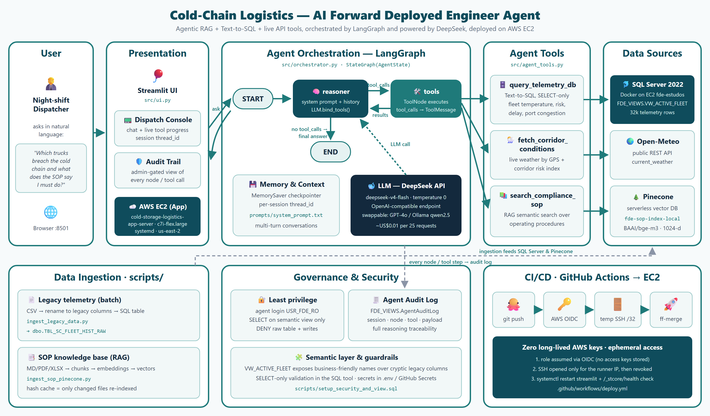
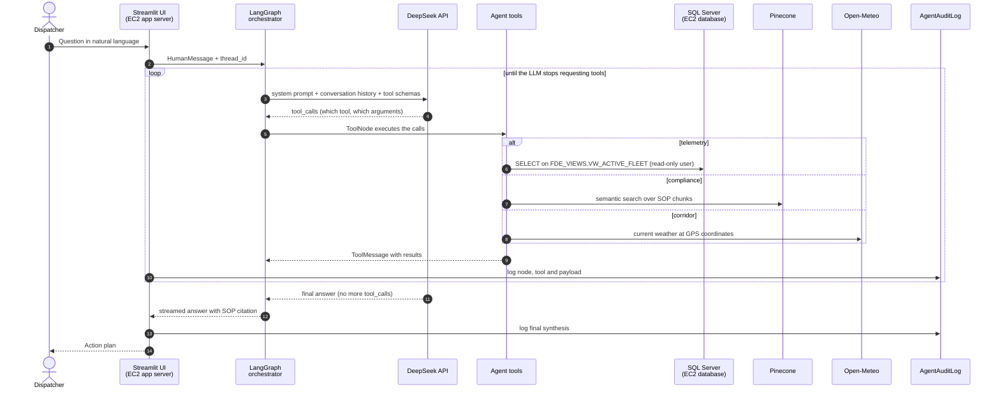
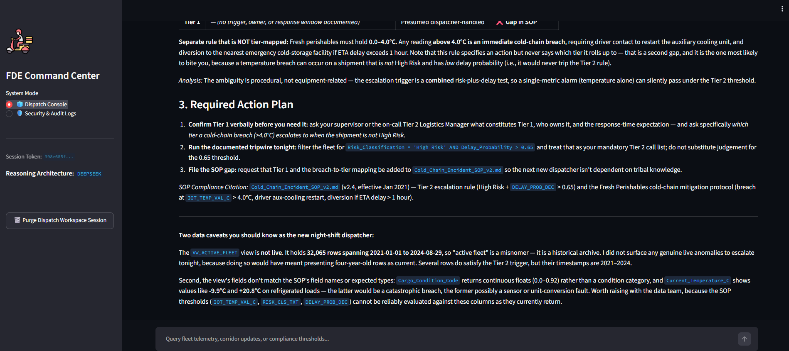
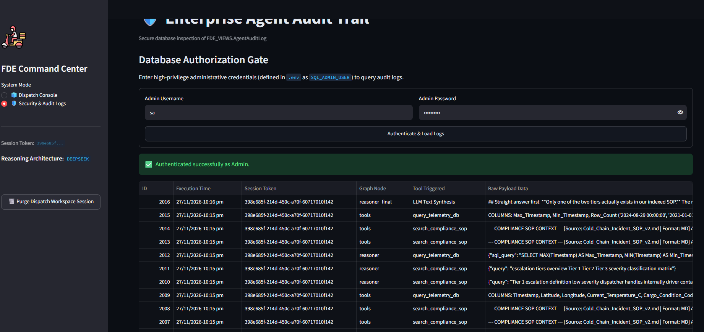

# ❄️ Cold-Chain Logistics — AI Forward Deployed Engineer Agent

> An enterprise AI agent that helps logistics dispatchers detect cold-chain breaches, check live corridor conditions and apply company SOPs — in plain language, with full audit traceability.


---

## 📌 Table of Contents

1. [The business problem](#-the-business-problem)
2. [Architecture](#-architecture)
3. [End-to-end flow: start → middle → end](#-end-to-end-flow-start--middle--end)
4. [Agent tools](#-agent-tools)
5. [Tech stack](#-tech-stack)
6. [Repository structure](#-repository-structure)
7. [Getting started](#-getting-started)
8. [Deployment & infrastructure](#-deployment--infrastructure)
9. [Security & governance](#-security--governance)
10. [Screenshots](#-screenshots)
11. [Roadmap](#-roadmap)

---

## 🎯 The business problem

A refrigerated-freight operator runs a fleet whose telemetry lives in a **legacy SQL Server** with cryptic column names (`IOT_TEMP_VAL_C`, `PRT_CNG_LVL`, `RISK_CLS_TXT`…). Its operating rules live in a **Standard Operating Procedure (SOP)** document. A night-shift dispatcher has to cross three worlds under time pressure:

| Question the dispatcher has | Where the answer lives |
|---|---|
| *Which shipments are above 4.0 °C?* | Legacy telemetry database |
| *Is the corridor near that truck disrupted right now?* | Live weather API |
| *What am I required to do, and who do I escalate to?* | SOP document (e.g. breach > 4.0 °C, port congestion > 7.0, High Risk + delay > 0.65 → Tier 2) |

This project delivers what a **Forward Deployed Engineer** would build on site: an agent that sits on top of the client's existing systems — without migrating them — and answers these questions in one conversation, citing the SOP and logging every step it takes.

---

## 🏗️ Architecture



<sub>Editable source: [`docs/images/architecture.svg`](docs/images/architecture.svg)</sub>

| Layer | Component | Where |
|---|---|---|
| Presentation | Streamlit app: **Dispatch Console** (chat) + **Audit Trail** (admin) | `src/ui.py` |
| Orchestration | LangGraph `StateGraph` with a `reasoner ⇄ tools` loop and `MemorySaver` checkpointer | `src/orchestrator.py` |
| Reasoning | **DeepSeek API** (`deepseek-v4-flash`, OpenAI-compatible) — swappable for GPT-4o or local Ollama | `src/orchestrator.py` |
| Tools | Text-to-SQL, live corridor API, SOP retrieval (RAG) | `src/agent_tools.py` |
| Data | SQL Server 2022 (Docker), Pinecone vector index, Open-Meteo API | `scripts/` |
| Infra | 2 × AWS EC2 (app + database), GitHub Actions with OIDC | `.github/workflows/deploy.yml` |

---

## 🔄 End-to-end flow: start → middle → end



### 1️⃣ Start — the question

1. The dispatcher opens the **Dispatch Console** and types a question, e.g. *"Which High Risk shipments need escalation tonight, and what does the SOP require?"*
2. `ui.py` wraps it in a `HumanMessage` and calls `fde_agent.stream(...)` with the session's `thread_id`. The `MemorySaver` checkpointer restores the conversation history for that thread, so follow-up questions keep context.

### 2️⃣ Middle — the reasoning loop

3. The **`reasoner`** node sends the system prompt (`src/prompts/system_prompt.txt`) + history to **DeepSeek**, with the three tools bound via `bind_tools`.
4. The LLM decides — it is not a fixed pipeline — whether it needs data. If it emits `tool_calls`, `tools_condition` routes to the **`tools`** node (`ToolNode`), which executes them:
   - `query_telemetry_db` → runs a SELECT-only T-SQL query against the semantic view;
   - `search_compliance_sop` → embeds the query and retrieves the closest SOP chunks from Pinecone;
   - `fetch_corridor_conditions` → calls Open-Meteo for live weather at the truck's coordinates.
5. Results return as `ToolMessage`s to the reasoner, which can call more tools (zero, one or many, in any order) until it has enough evidence.
6. Meanwhile, the UI streams each step as live progress and writes it to **`FDE_VIEWS.AgentAuditLog`** (session, node, tool, payload).

### 3️⃣ End — the answer and the trail

7. When the LLM replies without `tool_calls`, the graph reaches `END`. The dispatcher receives an **action plan** grounded in the data and citing the SOP section.
8. A supervisor can open **Security & Audit Logs**, authenticate as admin, and inspect every reasoning step and tool payload of that session — full traceability of what the agent saw and did.

---

## 🧰 Agent tools

| Tool | Purpose | Backend | Guardrail |
|---|---|---|---|
| `query_telemetry_db` | Text-to-SQL over fleet telemetry: temperature, risk class, delay probability, port congestion, route risk | SQL Server view `FDE_VIEWS.VW_ACTIVE_FLEET` | SELECT-only check in code **+** read-only DB login; returns at most 10 rows |
| `search_compliance_sop` | Retrieves relevant SOP passages for grounding and citation | Pinecone (`fde-sop-index-local`, BAAI/bge-m3, 1024-d) or OpenAI embeddings (1536-d) | Answers cite the source document |
| `fetch_corridor_conditions` | Live temperature + wind at GPS coordinates and a derived corridor risk index | Open-Meteo REST API | 6 s timeout, graceful error message |

---

## 🛠️ Tech stack

- **Agent framework:** LangGraph, LangChain
- **LLM:** DeepSeek API (`deepseek-v4-flash`) · alternatives: OpenAI GPT-4o, Ollama `qwen2.5:7b` (set with `Agent_llm`)
- **RAG:** Pinecone serverless, Hugging Face `BAAI/bge-m3` (local) or OpenAI embeddings (set with `Embeddings_model`)
- **Data:** SQL Server 2022 in Docker, SQLAlchemy + pyodbc, pandas
- **UI:** Streamlit
- **Cloud & DevOps:** AWS EC2 (Ubuntu, systemd), GitHub Actions, AWS IAM OIDC federation

**Running cost:** the DeepSeek API cost about **US$ 0.01 for 25 agent requests (~87k tokens)** over 30 days of development — cheap enough to run real multi-step reasoning in a demo environment.

---

## 📁 Repository structure

```
.
├── src/
│   ├── ui.py                  # Streamlit app: Dispatch Console + Audit Trail
│   ├── orchestrator.py        # LangGraph graph, LLM selection, memory
│   ├── agent_tools.py         # The 3 tools: SQL, corridor API, SOP RAG
│   └── prompts/
│       └── system_prompt.txt  # Agent persona, rules and answer format
├── scripts/                   # One-time setup / data preparation
│   ├── ingest_legacy_data.py        # CSV → legacy-style SQL Server table
│   ├── setup_security_and_view.sql  # Semantic view + read-only agent login
│   ├── ingest_sop_pinecone.py       # SOP → chunks → embeddings → Pinecone
│   └── demo_similaridade_vetorial.py# Educational demo of vector similarity
├── data/cache/                # Hash cache: only changed SOP files are re-indexed
├── deploy/iam/                # IAM trust + security-group policies for OIDC deploy
├── docs/images/               # Architecture diagram and screenshots
├── .github/workflows/deploy.yml
└── requirements.txt
```

---

## 🚀 Getting started

### Prerequisites

- Python 3.12, **ODBC Driver 18 for SQL Server**
- Docker (for SQL Server 2022)
- API keys: DeepSeek, Pinecone (OpenAI optional)

### 1. Install

```bash
git clone https://github.com/Gabrielxdev/cold-chain-logistics-FDE.git
cd cold-chain-logistics-FDE
python -m venv .venv && source .venv/bin/activate   # Windows: .venv\Scripts\activate
pip install -r requirements.txt
```

### 2. Configure `.env`

```ini
# LLM
Agent_llm=DEEPSEEK              # DEEPSEEK | OPENAI | OLLAMA
DEEPSEEK_API_KEY=...
# OPENAI_API_KEY=...            # only if Agent_llm=OPENAI or Embeddings_model=OPENAI

# RAG
PINECONE_API_KEY=...
Embeddings_model=LOCAL          # LOCAL (bge-m3) | OPENAI
Local_Embedding_Model=BAAI/bge-m3

# SQL Server
SQL_SERVER_HOST=localhost
SQL_SERVER_PORT=1433
SQL_ADMIN_USER=sa               # used by ingestion and the Audit Trail login
SQL_ADMIN_PASSWORD=...
SQL_AGENT_USER=USR_FDE_RO       # read-only login used by the agent
SQL_AGENT_PASSWORD=...
```

### 3. Prepare the data (run once, in order)

```bash
# a) Start SQL Server 2022
docker run -d --name legacy-mssql -e ACCEPT_EULA=Y -e MSSQL_SA_PASSWORD='<strong-password>' \
  -p 127.0.0.1:1433:1433 -v mssql_data:/var/opt/mssql mcr.microsoft.com/mssql/server:2022-latest

# b) Load the telemetry CSV (data/raw/) into the legacy table
python scripts/ingest_legacy_data.py

# c) Create the semantic view, the read-only agent login and its grants
#    (run scripts/setup_security_and_view.sql as admin; also create FDE_VIEWS.AgentAuditLog
#     and grant INSERT on it to the agent login)

# d) Index the SOP documents (data/policy/) into Pinecone
python scripts/ingest_sop_pinecone.py
```

### 4. Run

```bash
streamlit run src/ui.py          # http://localhost:8501
# or test the agent in the terminal:
python src/orchestrator.py
```

---

## ☁️ Deployment & infrastructure

The solution runs on **two EC2 instances in `us-east-2`**, separating compute from data:

| Instance | Type | Role |
|---|---|---|
| `cold-storage-logistics-app-server-test` | c7i-flex.large | Streamlit app + LangGraph agent, served by a `systemd` unit on port 8501 |
| `fde-estudos` | c7i-flex.large | SQL Server 2022 in Docker (`legacy-mssql`), port published only on `127.0.0.1` with a persistent volume |

### CI/CD pipeline (`.github/workflows/deploy.yml`)

Every push to `main` deploys automatically:

1. **Authenticate with AWS via OIDC** — GitHub assumes an IAM role with short-lived credentials; no AWS access keys are stored anywhere.
2. **Open SSH just for the runner** — detects the runner's public IPv4 and adds a temporary `/32` rule on port 22 to the security group.
3. **Deploy** — over SSH: checks the server is on a clean `main`, `git merge --ff-only` to the exact commit, `systemctl restart streamlit`.
4. **Health check** — polls `/_stcore/health` and verifies the service is active.
5. **Revoke access** — removes the temporary SSH rule, even if the deploy failed (retries for eventual consistency).

---

## 🔐 Security & governance

- **Least privilege at the database:** the agent connects as `USR_FDE_RO`, which can only `SELECT` the semantic view; the raw table and all writes on `dbo` are explicitly denied.
- **Defense in depth on Text-to-SQL:** the tool rejects any statement that is not a `SELECT` before reaching the database.
- **Semantic layer:** `VW_ACTIVE_FLEET` translates cryptic legacy columns into business names, which also makes LLM-generated SQL more accurate.
- **Auditability:** every reasoner step and tool call is persisted in `FDE_VIEWS.AgentAuditLog`; reading it requires admin credentials.
- **Secrets:** kept in `.env` (git-ignored) locally and in GitHub Environment Secrets for CI/CD.
- **Ephemeral infrastructure access:** OIDC instead of static keys; SSH opened per-run for a single IP.

---

## 📸 Screenshots

**Dispatch Console** — the agent cross-checks telemetry against the SOP, delivers an action plan and flags data-quality caveats it found along the way.



**Enterprise Agent Audit Trail** — every node and tool call of the session, with the exact SQL and SOP queries the agent issued.



---

## 🗺️ Roadmap

- [ ] Persistent checkpointer (SQLite/Postgres) so conversations survive restarts
- [ ] Private networking between app and database (no public DB exposure, AWS Secrets Manager)
- [ ] HTTPS reverse proxy + SSO in front of Streamlit
- [ ] Evaluation suite for SQL accuracy and SOP-citation faithfulness (LangSmith)
- [ ] Streaming telemetry ingestion instead of batch CSV

---

## 👤 Author

**Gabriel Thiago** — [GitHub @Gabrielxdev](https://github.com/Gabrielxdev)

If this project was useful, leave a ⭐!
